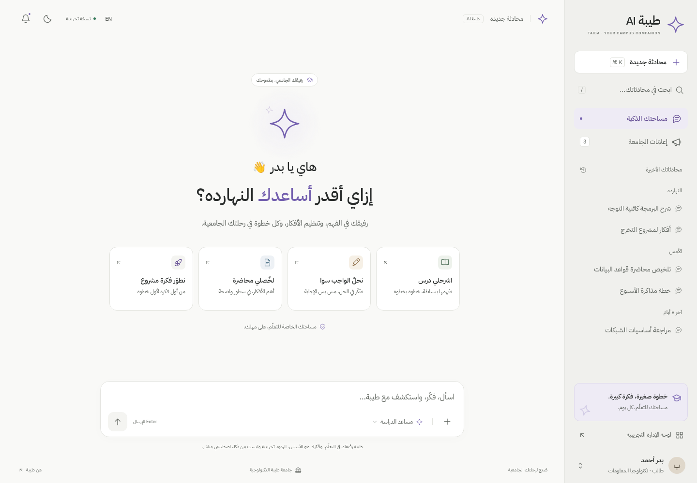
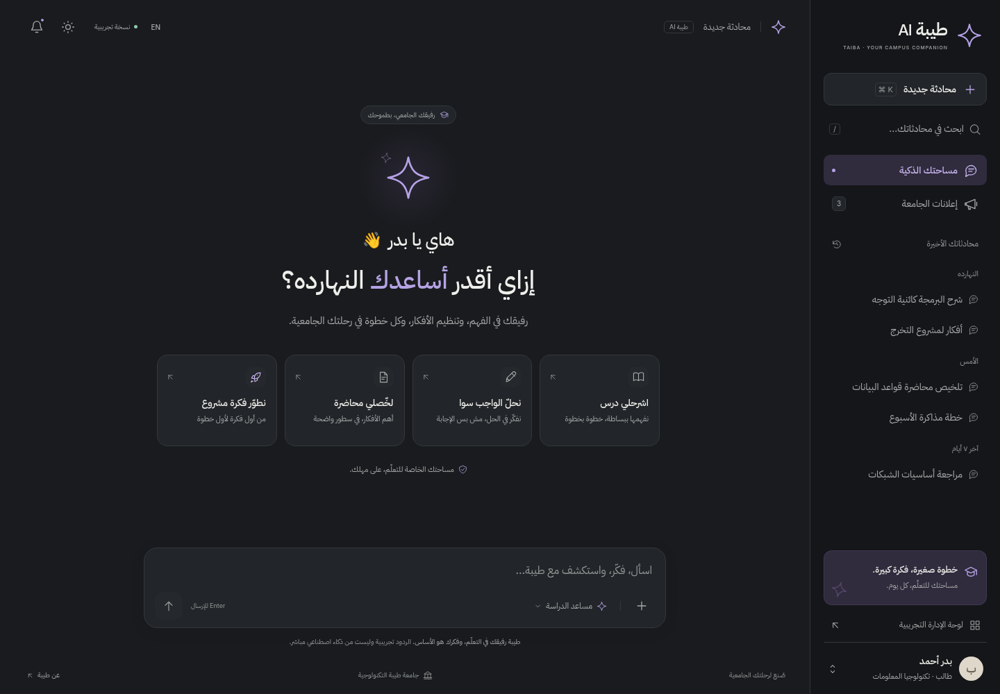

# ✦ طيبة AI — التصميم الأصلي، بصقل أفضل

**الإصدار الحالي يعيد الهوية الأصلية المحبوبة:** النجمة الرباعية ✦، والبنفسجي #7460AF، والأبيض الدافئ #F9F9F7، والواجهة المألوفة للمحادثات.

## افتح النسخة الحالية

1. اضغط **Code → Download ZIP**.
2. فك الضغط على جهازك.
3. افتح **Taiba_AI_Original_Style_Premium_Refinement.html** بالمتصفح.

هذه النسخة تضم الخطوط والتصميم والتفاعلات، ولا تحتاج تثبيت حزم أو تشغيل خادم. عند فتح HTML داخل GitHub، اضغط **Download raw file** لتنزيله؛ GitHub يعرض المصدر ولا يشغّل الواجهة داخل صفحة الملف.

- [نسخة HTML الجاهزة](Taiba_AI_Original_Style_Premium_Refinement.html)
- [الحزمة المطلوبة ZIP](Taiba_AI_Original_Style_Premium_Refinement.zip)
- [المصدر ودليل التشغيل](taiba-ai-original-refined/README.md)
- [ملاحظات إصلاح لوحة المفاتيح](taiba-ai-original-refined/KEYBOARD_FIX_NOTES.md)
- [الاختبارات والقيود](taiba-ai-original-refined/docs/TESTING.md)

## الهوية الأصلية محفوظة

التحسينات تركز على وضوح العربية، وتنسيق الردود، وفقاعات المستخدم، ونسب الهاتف، وثبات حقل الكتابة، واحترام موضع القراءة أثناء الرد التدريجي. كل شاشات الدخول والحساب والإعلانات والإدارة باقية، مع إدارة 22 مزوّدًا ببيانات تجريبية.

تحققت الاختبارات من بقاء حقل الكتابة نفسه وتركيزه عبر الإرسال المتكرر، ومن قياسات الشاشة المصغّرة وتحديثات Visual Viewport المحاكية. **لم يُختبر iPhone أو Android فعلي، ولا محرك Safari**؛ تظل اختبارات الأجهزة مطلوبة قبل الإنتاج.

النموذج مستقل، ولا يتصل بمصادقة أو قواعد بيانات أو خدمات AI أو Cloudflare. لم يُنشر موقع.

## الإصدارات السابقة محفوظة

- [التصميم الأول](taiba-ai-design/README.md)
- [تجربة رواق السابقة](taiba-ai-reimagined/README.md)
