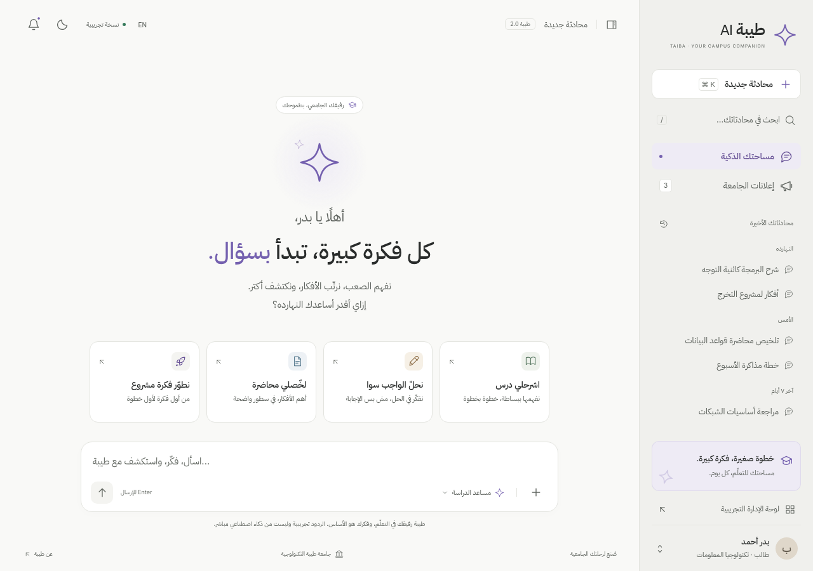

# طيبة AI — النموذج التفاعلي

واجهة جامعية تجريبية مبنية بـ HTML وCSS وJavaScript، مع دعم العربية والإنجليزية والمظهرين الفاتح والداكن.

## فتح النسخة الجاهزة

1. اضغط **Code → Download ZIP** من صفحة المستودع.
2. فك ضغط الملف على جهازك.
3. افتح **Taiba_AI_Standalone.html** في المتصفح.

نسخة HTML تضم الخطوط والتصميم والتفاعلات، ولا تحتاج تثبيت حزم أو تشغيل خادم. عند فتح الملف داخل GitHub، استخدم زر **Download raw file** لتنزيله؛ GitHub يعرض المصدر ولا يشغّل HTML داخل صفحة الملف.

- [نسخة HTML المستقلة](Taiba_AI_Standalone.html)
- [حزمة المشروع ZIP](Taiba_AI_Premium_UI_Design.zip)
- [المصدر ودليل التشغيل](taiba-ai-design/README.md)
- [نتائج الاختبارات والقيود](taiba-ai-design/docs/TESTING.md)

## معاينة التصميم

النموذج يستخدم بيانات وردودًا تجريبية فقط، ولا يتصل بخدمات خلفية أو ذكاء اصطناعي. لم يتم نشر موقع أو ربط خدمات إنتاج.
