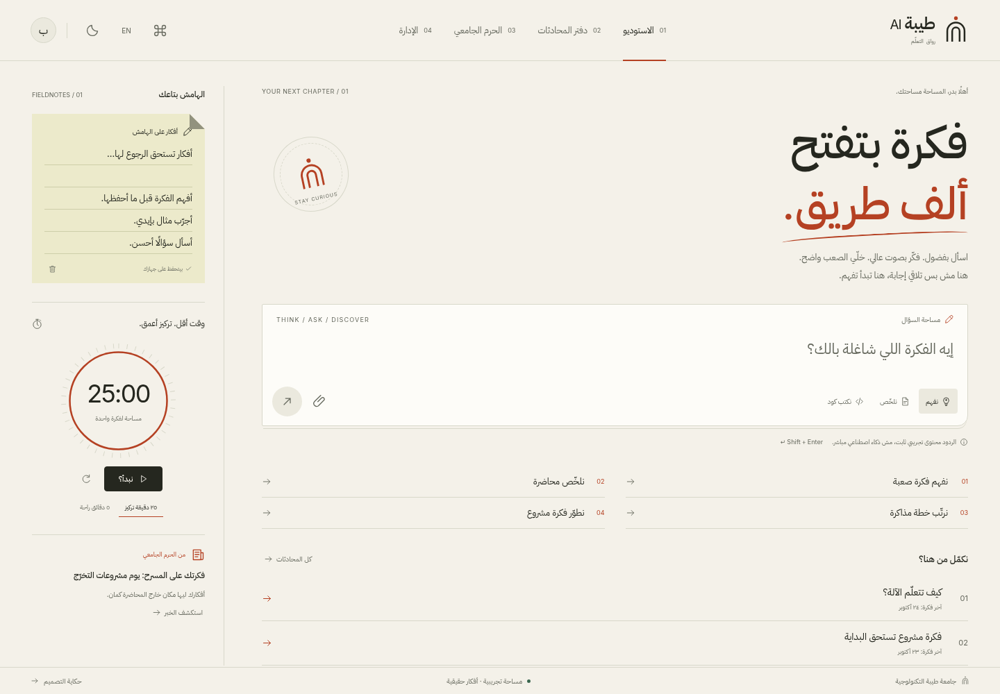
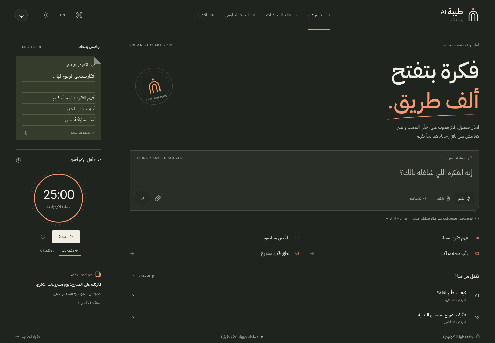

# طيبة AI — رواق التعلّم

**الإصدار الجديد: Learning Studio / رواق.**

تجربة جديدة بتكوين غير متناظر، ودفتر أفكار فعلي، ومؤقّت تركيز، ومحادثات على هيئة أوراق قراءة مرقّمة، وتنقّل سفلي مصمّم للهاتف.

## افتح النسخة الجديدة

1. اضغط **Code → Download ZIP** من صفحة المستودع.
2. فك الضغط على جهازك.
3. افتح **Taiba_AI_Riwaq.html** بالمتصفح.

الملف يضم الخطوط والتصميم والتفاعلات؛ لا يحتاج تثبيت حزم أو تشغيل خادم. عند استعراض HTML داخل GitHub، استخدم **Download raw file** لتنزيله؛ صفحة GitHub تعرض المصدر ولا تشغّل الواجهة.

- [نسخة رواق المكتفية ذاتيًا](Taiba_AI_Riwaq.html)
- [حزمة المصدر والتوثيق والصور ZIP](Taiba_AI_Riwaq_Design.zip)
- [دليل رواق الكامل](taiba-ai-reimagined/README.md)
- [استكشاف المفاهيم الثلاثة](taiba-ai-reimagined/docs/CONCEPTS.md)
- [معرض المفاهيم التفاعلي — افتحه بعد تنزيل المستودع](taiba-ai-reimagined/concepts.html)
- [تقارير الاختبار والقيود](taiba-ai-reimagined/docs/TESTING.md)

## رواق: التكوين الجديد

الفكرة المختارة جاءت بعد استكشاف ثلاثة اتجاهات مستقلة: مجلة معرفية، ومسرح ذكاء سياقي، واستوديو تعلّم. الاختلافات تشمل التنقّل والتكوين والهرمية ونمط العمل، وليس الألوان وحدها.

## التحقق

- 22 مجموعة فحص وظيفية ناجحة.
- 60 فحص إتاحة آليًا دون مخالفات في القواعد المختارة؛ لا تمثل شهادة امتثال كاملة.
- مقاسات 320، 360، 375، 390، 430، 768، 1280 بكسل.
- 22 مزوّدًا في لوحة الإدارة ببيانات عرض فقط.
- دعم العربية والإنجليزية والمظهرين الفاتح والداكن.

سلوك لوحة المفاتيح على iPhone وAndroid الفعليين ما زال يحتاج اختبار أجهزة. النموذج محلي تجريبي ولا يتصل بخلفية أو قواعد بيانات أو خدمات AI. لم يتم نشر موقع.

## الإصدار السابق

محفوظ كما هو: [المصدر الأول](taiba-ai-design/README.md) · [HTML الأول](Taiba_AI_Standalone.html) · [الحزمة الأولى](Taiba_AI_Premium_UI_Design.zip).
